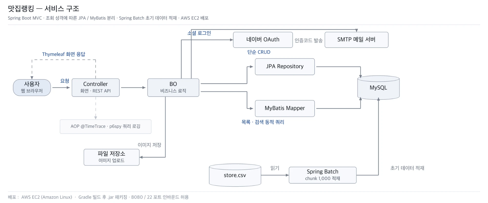
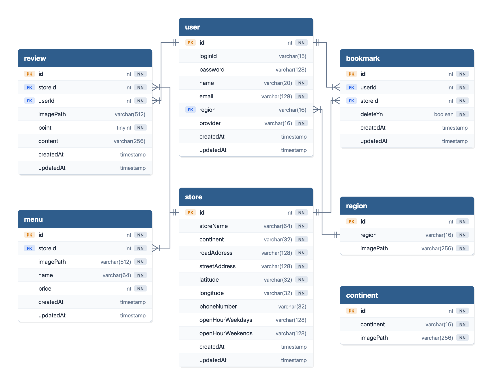

# 🍽️ 맛집랭킹 (Matjip Ranking)

전국 **세계 음식점** 데이터를 기반으로, 지역·대륙별 맛집을 탐색하고 리뷰·별점·북마크로 나만의 맛집 랭킹을 만들어가는 웹 서비스입니다.

공공데이터(전국 세계음식 음식점 정보, 약 9,500건)를 Spring Batch로 적재하고, 사용자의 리뷰 데이터를 바탕으로 **별점순 / 리뷰 많은 순** 정렬을 제공합니다.

<br>

## 📌 목차

- [주요 기능](#-주요-기능)
- [기술 스택](#-기술-스택)
- [시스템 아키텍처](#-시스템-아키텍처)
- [ERD](#-erd)
- [프로젝트 구조](#-프로젝트-구조)
- [주요 구현 내용](#-주요-구현-내용)
- [API / 화면 목록](#-api--화면-목록)
- [배포](#-배포)

<br>

## ✨ 주요 기능

### 👤 회원
- 회원가입 (아이디 중복 확인, 관심 지역 선택), 로그인 / 로그아웃
- **네이버 소셜 로그인** (OAuth 2.0)
- 아이디 찾기 (이름 + 이메일)
- 비밀번호 찾기 — **이메일 인증번호 발송** 후 비밀번호 재설정
- 회원정보 수정 (현재 비밀번호 확인 후 수정)

### 🍜 맛집 탐색
- **내 지역 맛집**: 로그인 시 회원가입 때 선택한 관심 지역의 맛집을 우선 노출
- **지역별 / 대륙별 맛집**: 17개 시·도, 동아시아·동남아시아·유럽·북미 등 음식 대륙별 분류
- **맛집 검색**: 가게 이름 키워드 검색
- **정렬**: 기본순 / 별점 높은 순 / 리뷰 많은 순
- 페이지네이션 (10개 단위, 10페이지 그룹)

### 📄 맛집 상세
- 메뉴 탭 (메뉴 이미지, 이름, 가격)
- 리뷰 탭 (사진 첨부, 별점, 내용 / 본인 리뷰 삭제)
- 정보 탭 (주소, 전화번호, 평일·주말 영업시간, **카카오맵** 위치 표시)
- 평균 별점, 리뷰 수, 북마크 수

### ❤️ 마이 맛집
- **북마크한 맛집**: 하트 버튼으로 북마크 추가 / 해제 (soft delete)
- **최근 방문한 맛집**: 내가 리뷰를 작성한 맛집
- **단골 맛집**: 같은 맛집에 리뷰를 **3회 이상** 작성한 맛집

### 🛠️ 관리자
- 맛집 목록 조회 / 검색 / 정렬
- 맛집 등록 · 삭제
- 메뉴 등록 (이미지 업로드) · 삭제

<br>

## 🛠 기술 스택

| 구분 | 기술 |
| --- | --- |
| **Language** | Java 17 |
| **Framework** | Spring Boot 3.1.0, Spring Batch 5, Spring AOP |
| **Persistence** | Spring Data JPA (Hibernate), MyBatis 3 |
| **Database** | MySQL 8 |
| **View** | Thymeleaf, Thymeleaf Layout Dialect, Bootstrap 4.6, jQuery 3.7 |
| **Security** | Spring Security Crypto (BCrypt) |
| **External API** | Naver Login API, Kakao Maps API, SMTP(Gmail) |
| **Build / Tool** | Gradle, Lombok, P6Spy, Spring DevTools |

<br>

## 🏗 시스템 아키텍처



- **Controller → BO → Repository / Mapper** 계층 구조
- 단순 CRUD는 **JPA Repository**, 목록·검색 등 동적 쿼리는 **MyBatis Mapper**로 분리
- 애플리케이션 시작 시 **Spring Batch**가 `store.csv`를 chunk 1,000 단위로 MySQL에 초기 적재
- 외부 연동: **네이버 OAuth**(소셜 로그인), **SMTP 메일 서버**(비밀번호 찾기 인증번호 발송)
- 배포: **AWS EC2 (Amazon Linux)**, Gradle 빌드 후 `.jar` 패키징하여 실행

<br>

## 🗂 ERD



| 테이블 | 설명 |
| --- | --- |
| `user` | 회원 (일반 / 네이버 `provider` 구분, 관심 지역) |
| `store` | 맛집 (이름, 음식 대륙, 도로명·지번 주소, 위경도, 전화번호, 영업시간) |
| `menu` | 맛집별 메뉴 (이미지, 이름, 가격) |
| `review` | 리뷰 (작성자, 맛집, 사진, 별점, 내용) |
| `bookmark` | 북마크 (`deleteYn`으로 soft delete) |
| `region` | 지역 카테고리 (시·도 + 대표 이미지) |
| `continent` | 음식 대륙 카테고리 (대륙명 + 대표 이미지) |

**관계**
- `user` 1 : N `review`, `user` 1 : N `bookmark`
- `store` 1 : N `review`, `store` 1 : N `menu`, `store` 1 : N `bookmark`
- `region` 1 : N `user` (`user.region` → `region.region`, 회원의 관심 지역)

<br>

## 📁 프로젝트 구조

도메인(기능) 단위로 패키지를 나누고, 각 도메인은 `Controller → BO(Service) → Repository/Mapper` 계층으로 구성했습니다.

```
src/main/java/com/project_250131
├── admin/          # 관리자 - 맛집/메뉴 등록·삭제
├── aop/            # @TimeTrace 실행시간 측정 AOP
├── bookmark/       # 북마크 (MyBatis)
├── common/         # 파일 업로드(FileManagerService), BCrypt 암호화
├── config/         # WebMvc, Mail, Naver OAuth 설정
├── continent/      # 대륙 카테고리 (JPA)
├── menu/           # 메뉴 (MyBatis)
├── region/         # 지역 카테고리 (JPA)
├── review/         # 리뷰 (MyBatis)
├── store/          # 맛집 목록·상세·검색 (JPA) + CSV 배치
│   └── batch/      # Spring Batch - CSV → DB 적재
└── user/           # 회원, 네이버 로그인, 메일 인증

src/main/resources
├── csv/store.csv   # 공공데이터 원본 (전국 세계음식 음식점)
├── mappers/        # MyBatis XML 매퍼
├── static/         # CSS, 지역/대륙 대표 이미지
└── templates/      # Thymeleaf 화면 (layout / fragments / 도메인별)
```

<br>

## 💡 주요 구현 내용

### 1. Spring Batch를 이용한 공공데이터 적재
- `csv/store.csv`(약 9,500건)를 `FlatFileItemReader`로 읽어 필요한 컬럼(가게명, 음식 분류, 위경도, 주소, 전화번호, 영업시간)만 추출
- `chunk(1000)` 단위로 `ItemWriter`에서 `saveAll()` 처리
- 애플리케이션 시작 시 `CommandLineRunner`로 Job 실행

### 2. JPA + MyBatis 혼용
- 단순 조회/저장 위주의 `user`, `store`, `region`, `continent`는 **Spring Data JPA**
- 집계·조건이 많은 `review`, `bookmark`, `menu`는 **MyBatis** XML 매퍼로 SQL 직접 작성
  - 예) 단골 맛집: `GROUP BY storeId HAVING COUNT(*) >= 3`

### 3. 맛집 랭킹 정렬
- 각 맛집의 평균 별점과 리뷰 수를 계산해 `StoreDTO`에 담고, `Comparator`로 별점순 / 리뷰순 정렬
- 정렬된 목록에 대해 `Pageable` 기반 페이지네이션 적용

### 4. 인증
- 비밀번호는 **BCrypt** 해시로 저장
- 세션 기반 로그인 (`userId`, `userName`, `userRegion`, `userProvider` 등 세션 저장)
- 네이버 OAuth 2.0: 인가 코드 → Access Token → 사용자 정보 조회 → 이메일 기준 신규 가입 / 로그인
- 비밀번호 찾기: `@Async` 비동기 메일 발송으로 6자리 인증번호 전송

### 5. 파일 업로드
- 메뉴 이미지 / 리뷰 사진을 로컬 디렉터리에 `{storeId}_{userId}_{timestamp}` 폴더로 저장
- `WebMvcConfig`에서 `/images/**` 경로를 업로드 폴더에 매핑
- 리뷰·메뉴 삭제 시 파일 및 폴더도 함께 삭제

### 6. AOP 실행시간 측정
- 커스텀 어노테이션 `@TimeTrace`를 붙인 메서드의 실행시간을 `StopWatch`로 측정해 로깅

<br>

## 📋 API / 화면 목록

<details>
<summary>펼쳐보기</summary>

#### 화면 (View)

| URL | 설명 |
| --- | --- |
| `GET /store/user-store-list` | 메인 - 내 지역 맛집 (비로그인 시 전체) |
| `GET /store/store-list` | 지역 / 대륙별 맛집 목록 |
| `GET /store/search-list` | 맛집 검색 결과 |
| `GET /store/bookmark-store-list` | 북마크한 맛집 |
| `GET /store/visit-store-list` | 최근 방문한 맛집 |
| `GET /store/regular-store-list` | 단골 맛집 |
| `GET /store/store-detail` | 맛집 상세 (메뉴 / 리뷰 / 정보 탭) |
| `GET /region/region-list` | 지역 선택 |
| `GET /continent/continent-list` | 대륙 선택 |
| `GET /user/sign-in`, `/user/sign-up` | 로그인, 회원가입 |
| `GET /user/naver-login` | 네이버 로그인 |
| `GET /user/edit-profile` | 회원정보 수정 |
| `GET /user/find-loginId`, `/user/find-password` | 아이디 / 비밀번호 찾기 |
| `GET /admin/store-list` | 관리자 - 맛집 목록 |
| `GET /admin/store-detail` | 관리자 - 맛집 상세 / 메뉴 관리 |
| `GET /admin/add-store` | 관리자 - 맛집 등록 |

#### API (REST)

| Method | URL | 설명 |
| --- | --- | --- |
| GET | `/user/is-duplicate-id` | 아이디 중복 확인 |
| POST | `/user/sign-up` | 회원가입 |
| POST | `/user/sign-in` | 로그인 |
| GET | `/user/check-password` | 현재 비밀번호 확인 |
| PATCH | `/user/edit-profile` | 회원정보 수정 |
| POST | `/user/find-loginId` | 아이디 찾기 |
| POST | `/user/find-password` | 비밀번호 찾기 (회원 확인) |
| GET | `/user/send-passcode` | 이메일 인증번호 발송 |
| POST | `/user/check-passcode` | 인증번호 확인 |
| PATCH | `/user/change-password` | 비밀번호 변경 |
| POST | `/bookmark/store` | 북마크 추가 / 해제 |
| POST | `/review/create` | 리뷰 작성 |
| DELETE | `/review/delete` | 리뷰 삭제 |
| POST | `/admin/add-store` | 맛집 등록 |
| DELETE | `/admin/delete-store` | 맛집 삭제 |
| POST | `/admin/add-menu` | 메뉴 등록 |
| DELETE | `/admin/delete-menu` | 메뉴 삭제 |

</details>

<br>

## ☁️ 배포

**AWS EC2 (Amazon Linux)** 인스턴스 1대에 직접 배포했습니다.

1. EC2 인스턴스 생성 후 보안 그룹 인바운드 규칙에 **22(SSH)**, **8080(애플리케이션)** 포트 허용
2. 서버에 JDK 17, MySQL 설치 및 DB 생성
3. 로컬에서 `./gradlew build`로 `.jar` 빌드 후 서버에 업로드
4. `nohup java -jar` 로 백그라운드 실행 (시작 시 Spring Batch가 맛집 데이터 초기 적재)

<br>

## 📎 데이터 출처

- 공공데이터포털 — 전국 세계음식 음식점 정보 (기준일 2022.11.30)
